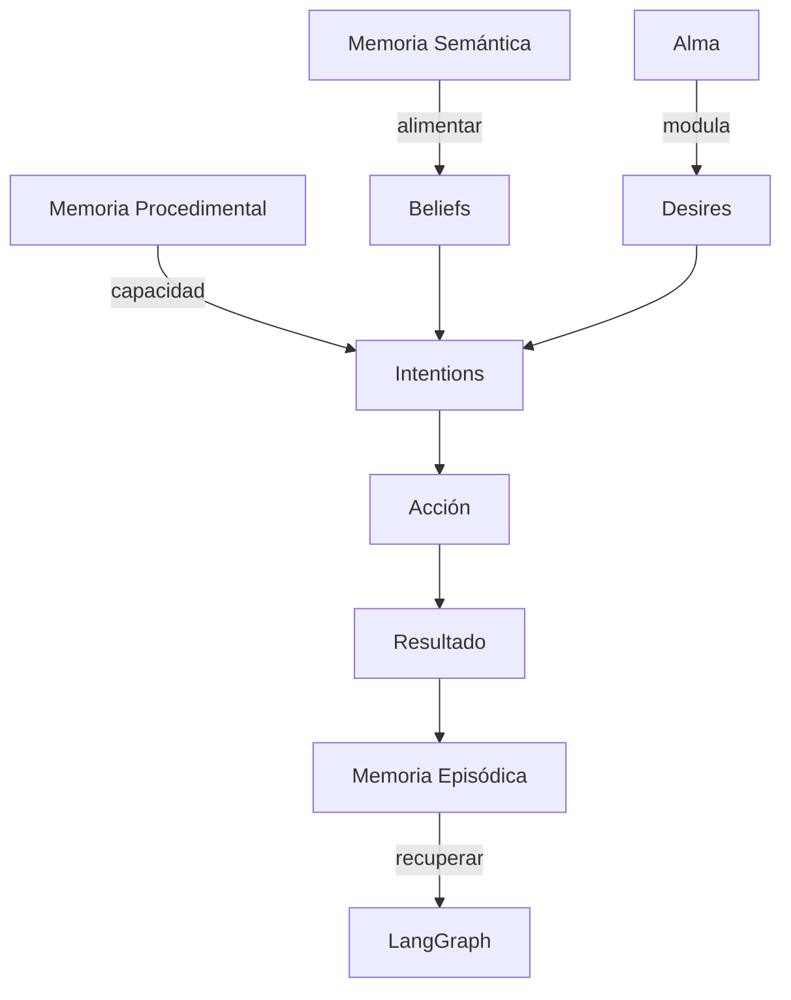
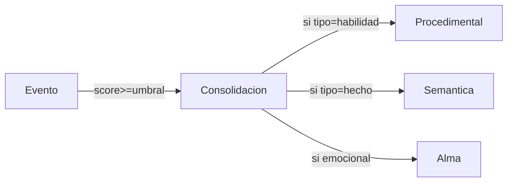

# Tratado de la Psique Artificial — Personalidad Compleja en MundoIA

**Última actualización:** 2026-04-26

Este documento describe, en detalle técnico y operativo, cómo se construye y mantiene la personalidad compleja de los agentes en MundoIA. Cubre la memoria tripartita (episódica, semántica, procedimental), el sistema BDI (Beliefs-Desires-Intentions), el componente `Alma` (rasgos, vectores éticos, evolución), y todos los parámetros y algoritmos principales que moldean la forma de interacción de un agente.

Tabla de contenido
- Resumen ejecutivo
- 1) Objetivos del diseño
- 2) Visión general de componentes
- 3) Memoria tripartita (modelado, persistencia, recuperación)
  - 3.1 Memoria episódica
  - 3.2 Memoria semántica
  - 3.3 Memoria procedimental
  - 3.4 Algoritmo de recuperación por relevancia
- 4) Sistema BDI: integración con memoria y personalidad
- 5) `Alma` y rasgos de personalidad (modelo, actualización, fórmulas)
- 6) Grafo social y dinámica de relaciones
- 7) Skills, competencias y aprendizaje procedimental
- 8) Flujo de decisión (pseudocódigo) y utilidades de acción
- 9) Métricas, experimentos y laboratorio de personalidad
- 10) Almacenamiento y esquema DB (JSONB) / ejemplos
- 11) Recomendaciones para ajustes y pruebas
- Apéndice: diagramas Mermaid y ejemplos de código

---

Resumen ejecutivo
-----------------

MundoIA construye personalidades complejas combinando: (a) una memoria persistente dividida en tres subsistemas; (b) un motor BDI que traduce creencias y necesidades en intenciones; (c) un `Alma` que actúa como filtro y modulador (rasgos y vectores éticos); y (d) un mecanismo de ejecución y consolidación (skills manager, registro episódico). El resultado: agentes con continuidad narrativa, sesgos realistas y aprendizaje acumulativo.

1) Objetivos del diseño
----------------------
- Generar agentes con continuidad personal (recuerdos que importan). 
- Permitir evolución de rasgos (personalidad mutable) basada en "experiencias clave".
- Mantener trazabilidad y reproducibilidad de experimentos (logs, métricas). 
- Ofrecer un conjunto parametrizable que permita ajustar niveles de plasticidad, olvido, y sensibilidad social.

2) Visión general de componentes
--------------------------------
- Memoria Persistente (systems/memoria_persistente.py)
  - Episódica, Semántica, Procedimental
  - Indexación opcional en ChromaDB para búsquedas semánticas
- Cerebro LangGraph (agents/cerebro_langgraph.py)
  - Orquesta el ciclo cognitivo, inyecta contexto en prompts, procesa resultados
- Skill Manager (core/skills_manager.py)
  - Contiene `crear_app`, `ejecutar_codigo`, y base_skills ejecutables
- `Alma` (agents/alma.py)
  - Módulo que maneja rasgos, epifanías y la evolución emocional
- Grafo social y MemoriaGrafica (systems/memoria) — gestiona relaciones con pesos
- Persistencia (PostgreSQL + JSONB) — guarda snapshot del agente (incluye campo `apps`)

3) Memoria tripartita: modelado, persistencia y recuperación
-----------------------------------------------------------

3.1 Memoria episódica (el "yo" narrativo)
- Contenido: eventos con metadata temporal y emocional.
- Estructura típica (ejemplo JSON):

```json
{
  "id": "mem_20260426_0001",
  "descripcion": "Fui atacado por ag_123",
  "turno": 123,
  "importancia": 0.92,
  "agentes_involucrados": ["ag_123"],
  "ubicacion": [10, 5],
  "emociones": ["miedo", "rabia"],
  "embedding_id": "vec_abc123"
}
```

- Scoring y retención: cada memoria episódica tiene `importancia` (0..1). El `Alma` y rasgos (ej. neuroticismo) re-escalan el score.
- Recuperación: combinación de similitud semántica (embedding) + recencia + importancia.

3.2 Memoria semántica (el "mundo" conocido)
- Contenido: proposiciones/creencias con certeza.
- Estructura típica:

```json
{
  "proposicion": "ag_123 es traidor",
  "certeza": 0.85,
  "fuente": "observacion_directa",
  "tags": ["seguridad", "reputacion"],
  "ultimo_update": 120
}
```

- Uso: alimenta `Beliefs` en BDI. Cambios en semántica tienen efectos directos en decisiones (ej. cooperación, comercio).

3.3 Memoria procedimental (el "cómo" hacer)
- Contenido: skills, recetas, pipelines, fragmentos de código y métricas de dominio.
- Estructura ejemplo:

```json
{
  "name": "craftear_cuchillo",
  "descripcion": "Secuencia para forjar un cuchillo de piedra",
  "dominio": 0.62,  // 0..1
  "uso_count": 42,
  "ejemplos": ["..."],
  "ultimo_uso_turno": 110
}
```

- Actualización: después de cada ejecución exitosa, `dominio` aumenta según una tasa de aprendizaje.

3.4 Algoritmo de recuperación por relevancia
- Score combinado para una memoria m:

$$
score(m) = \alpha \cdot sim(consulta, m) + \beta \cdot importancia(m) + \gamma \cdot recencia(m)
$$

donde
- $sim(consulta, m)$: similitud coseno entre embeddings (normalizado 0..1)
- $importancia(m)$: valor pre-calculado (0..1)
- $recencia(m) = e^{-\lambda (t_{ahora} - t_m)}$ (decay exponencial)
- $\,\alpha,\beta,\gamma$ son pesos que configuran la búsqueda (suma normalmente = 1)

Ejemplo de decaimiento:

$$
recencia = e^{-\lambda \Delta t}, \quad \Delta t = t_{now} - t_{mem}
$$

Parámetros recomendados por defecto: $\alpha=0.5, \beta=0.3, \gamma=0.2, \lambda=0.01$ (ajustables por agente via `Alma`).

4) Sistema BDI: integración con memoria y personalidad
-----------------------------------------------------

- `Beliefs`: representadas por la Memoria Semántica + percepciones recientes. Implementación práctica: `agente.beliefs` = diccionario actualizado cada turno con la salida de `buscar_por_relevancia` + perceptos.
- `Desires`: se generan desde necesidades (hambre, salud, descanso) y rasgos de personalidad (ambición, curiosidad). Cada `Desire` tiene prioridad calculada por una función de utilidad.
- `Intentions`: subset de `Desires` que se convertirán en plan. La selección usa heurísticas y una función de utilidad que incorpora costo, probabilidad de éxito (procedimental), riesgo social y recompensa.

Función de utilidad (ejemplo):

$$
U(a) = w_{needs} \cdot S_{needs}(a) + w_{beliefs} \cdot S_{beliefs}(a) - w_{cost} \cdot C(a) + w_{social} \cdot S_{social}(a)
$$

- $S_{needs}$: cuánto satisface la acción la necesidad (por ejemplo, comer satisface hambre).
- $S_{beliefs}$: compatibilidad con creencias (una acción que contradice creencias tiene penalización).
- $C(a)$: coste estimado (recursos, tiempo).
- $S_{social}$: impacto social esperado (reputación, riesgo de conflicto).

Pesos ($w_*$) se derivan del `Alma` y del estado actual de necesidades.

5) `Alma` y rasgos de personalidad: modelo, actualización, fórmulas
------------------------------------------------------------------

El `Alma` es un objeto que encapsula:
- Rasgos base (ej: `amabilidad`, `valentia`, `curiosidad`, `neuroticismo`, `ambicion`) cada uno en rango $[0.0, 1.0]$.
- Vectores éticos (`altruismo` vs `egoismo`, `orden` vs `caos`) en $[-1.0, 1.0]$ para expresar polaridad.
- Parámetros de plasticidad (qué tanto cambia cada rasgo frente a una experiencia): `plasticidad_rasgo` en $[0,1]$.
- Umbrales de consolidación de experiencia (ej. `umbral_importancia` default 0.8).

5.1 Actualización de rasgos — regla básica

Sea $T$ el valor actual de un rasgo y $\Delta$ el impacto subjetivo de la experiencia (puede ser valor emocional en [-1,1]). La actualización es:

$$
T_{new} = T_{old} + \eta \cdot I \cdot \Delta
$$

- $\eta$: tasa de aprendizaje del rasgo (plasticidad específica del agente).
- $I$: intensidad de la experiencia (0..1), derivada de `importancia` * `intensidad_emocional`.
- Si la experiencia es una `epifania` (reflexión profunda), podría multiplicarse por un factor mayor (ej. 2x).

Ejemplo con KaTeX: Si $T_{old}=0.7$, $\eta=0.05$, $I=0.9$ y $\Delta=-0.6$ (traición),

$$
T_{new} = 0.7 + 0.05 \cdot 0.9 \cdot (-0.6) = 0.7 - 0.027 = 0.673
$$

5.2 Regla de consolidación (episodica -> semantica/procedimental)
- Si `importancia >= umbral_importancia` y la experiencia se repite N veces en ventana W, se genera una consolidación:
  - Episódica -> Procedimental (si requiere habilidad) o Semántica (si es un hecho generalizable).
- Algoritmo simplificado:
  1. Si conteo_similares(W) >= N_consolidacion => consolidar
  2. Si consolidar y tipo=="habilidad" => crear entrada procedimental con `dominio` inicial = 0.1
  3. Si consolidar y tipo=="hecho" => crear/actualizar memoria semántica incrementando `certeza`

5.3 Parámetros de ejemplo por agente
- `plasticidad_global`: 0.02..0.2 (valor alto = personalidad más maleable)
- `umbral_importancia`: 0.7..0.95
- `decay_lambda` para recencia: 0.005..0.02
- `sesgo_emocional` (valora experiencias positivas vs negativas): -1.0..1.0

6) Grafo social y dinámica de relaciones
----------------------------------------
- Representación: grafo dirigido con pesos `r(u,v)` en [-1.0, 1.0].
- Actualización de peso tras interacción (ejemplo):

$$
r_{new} = r_{old} + \delta_{act} \cdot (1 - |r_{old}|)
$$

- Donde $\delta_{act}$ es el impacto de la acción sobre la relación (ej. ayudar +0.1, traicionar -0.4).
- Además, se aplica decay a conexiones inactivas para liberar memoria.

7) Skills, competencias y aprendizaje procedimental
--------------------------------------------------
- Cada skill tiene `dominio` $d \in [0,1]$.
- Aprende tras ejecuciones exitosas:

$$
d_{new} = \min(1.0, d_{old} + learning\_rate \cdot experience\_gain)
$$

- `experience_gain` puede ser función de dificultad y éxito. `learning_rate` depende de `Alma.plasticidad_procedimental`.
- `core/skills_manager.py` ya implementa `base_skills` y permite registrar skills creados por agentes (via `crear_habilidad`).

8) Flujo de decisión: pseudocódigo
---------------------------------

```python
def agente_step(agent, modelo):
    # 1) Recuperar contexto desde Memoria Persistente
    contexto = agent.memoria_persistente.buscar_por_relevancia(contexto_actual, top_k=8)

    # 2) Actualizar creencias (Beliefs)
    agent.beliefs.update(contexto['semanticas'])

    # 3) Generar deseos a partir de necesidades y rasgos
    deseos = generar_deseos(agent.necesidades, agent.alma)

    # 4) Calcular utilidades y seleccionar Intención
    intenciones = planificar(deseos, agent.beliefs, agent.memoria_procedimental, agent.alma)
    intencion = seleccionar_mejor(intenciones)

    # 5) Ejecutar (via skill_manager o herramientas)
    resultado = skill_manager.ejecutar_skill(intencion.skill_name, intencion.args, agente_id=agent.unique_id, agent_skills=agent.skills)

    # 6) Registrar resultado en Memoria Episódica
    agent.memoria_persistente.guardar_episodica(descripcion=resultado_text, turno=modelo.paso_actual, importancia=calcula_importancia(resultado))

    # 7) Actualizar Alma si es una experiencia clave
    if impacto_importante(resultado):
        agent.alma.aplicar_experiencia(resultado)

    # 8) Notificar y persistir
    modelo.log(...)
```

9) Métricas, experimentos y "Laboratorio de Personalidad"
---------------------------------------------------------
- Métricas importantes:
  - `trait_trace(agent, trait)` → evol. del valor del rasgo por turno
  - `mem_recall_quality` → precisión de recuperación semántica vs ground-truth
  - `skill_success_rate(skill, window)` → efectividad en ventana
  - `social_cohesion(group)` → promedio de fuerzas de relación
- Experimentos sugeridos:
  1. **Trauma controlado:** aplicar secuencia de traiciones a un agente y medir `amabilidad` y `tendencia a cooperar` (visualizar `trait_trace`).
  2. **Aprendizaje acelerado:** aumentar `plasticidad_procedimental` y medir velocidad de subida de `dominio` para skills.
  3. **Desinformación:** introducir proposiciones semánticas falsas y medir propagación en la red y su efecto en decisiones.

10) Almacenamiento y esquema DB (JSONB)
---------------------------------------
- La tabla `agentes` incluye columnas JSONB para `skills`, `memoria_persistente_data`, `apps`.
- Esquema recomendado para `apps` (campo JSONB):

```json
{
  "nombre_app": {
    "name": "auto_recolector",
    "file_path": "apps/ag_123/auto_recolector.py",
    "created_at": "2026-04-26T12:00:00Z",
    "metadata": {"descripcion": "script de recolección"}
  }
}
```

- Indexación: crear índices GIN/JSONB sobre keys frecuentes (skills, apps) y vectores en Chroma para búsquedas semánticas.

11) Recomendaciones y próximos pasos
-----------------------------------
- Exponer un conjunto de endpoints para pruebas A/B de parámetros de `Alma` (p.ej. `plasticidad_global`).
- Añadir hooks de instrumentación por agente: `trait_logger` que persista series temporales.
- Crear un módulo `lab_personality.py` que permita ejecutar perturbaciones reproducibles (seeded sequences de eventos) y capture métricas.

Apéndice: diagramas Mermaid y ejemplos
-------------------------------------

Flujo BDI ↔ Memoria ↔ Alma



Pipeline de consolidación



Ejemplo de función para actualizar rasgo (pseudocódigo):

```python
def aplicar_experiencia_al_alma(alma, experiencia):
    # experiencia: {"intensidad":0.9, "valencia":-0.6, "tipo":"traicion"}
    for rasgo in alma.rasgos_afectados_por(experiencia['tipo']):
        delta = map_valencia_a_delta(experiencia['valencia'])
        I = experiencia['intensidad']
        eta = alma.plasticidad[rasgo]
        alma.rasgos[rasgo] = clamp(0.0, 1.0, alma.rasgos[rasgo] + eta * I * delta)
```

---

Archivo relacionado que puede servir de referencia (implementaciones en el repo):
- [agents/cerebro_langgraph.py](agents/cerebro_langgraph.py#L560-L740)
- [core/skills_manager.py](core/skills_manager.py#L1-L200)
- [systems/herramientas.py](systems/herramientas.py#L1-L220)
- [systems/memoria_persistente.py](systems/memoria_persistente.py)

---

Si quieres, puedo:
- Generar automáticamente el módulo `lab_personality.py` con scripts reproducibles para experimentar.
- Añadir visualizaciones (notebook) que grafiquen `trait_trace` y `skill_success_rate` por agente.
- Ajustar los valores por defecto (`alpha,beta,gamma,lambda`) según tus necesidades.


---
*Documento generado automáticamente por la revisión del código del repo. Para modificaciones de formato o incluir ejemplos concretos de agentes (IDs), dime qué agente quieres usar como caso de estudio.*
